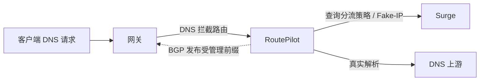

<p align="center">
  
</p>

# RoutePilot 🧭

**给 DNS 选路，让网关跟上。**

RoutePilot 是一款 macOS 状态栏应用，搭配 DNS 控制器和内置 GoBGP。它向 Surge 查询分流策略，为请求选择真实 DNS 或 Fake-IP，再把受管理的路由发布给网关。React 管理界面随 Go 后台一起打包，配置保存在 SQLite。

你负责决定网络怎么走，RoutePilot 负责让 DNS、路由和运行状态对得上。它不会自动修改 Surge、客户端 DNS 或网关配置。

[📦 下载最新版本](https://gitea.knotding.com/knot/routepilot/releases) · [初始设置](#第一次出航) · [远程管理](docs/remote-management.md) · [架构说明](docs/architecture.md)

## 能做什么？

| 场景 | RoutePilot 的做法 |
| --- | --- |
| DNS 分流 | 根据 Surge 策略选择真实地址或 Fake-IP，支持策略专用 UDP / TCP / DoT / DoH 上游 |
| 路由发布 | 支持 BGP、Static、Hybrid；发布固定 Fake-IP、DNS 拦截前缀和显式配置的手动路由 |
| 规则维护 | URL 导入先预览；可定时更新，单独同步 IPv4、IPv6 或两者 |
| 本地解析 | 手动配置域名与通配符，或从 Surge 的 `[Host]` 导入静态映射 |
| 看清现场 | DNS 查询详情、路由发布状态、健康监控、缓存、事件及独立连通性诊断 |
| 管理多台后端 | 中英文、明暗主题、本地和远程切换，本机登录凭证可选钥匙串或本地文件保存 |
| 更新与统计 | 自动检查 Release，在线升级；前后端版本不一致时提醒，DNS 累计统计重启后继续累加 |

## 三步打开驾驶舱

1. 从 [Releases](https://gitea.knotding.com/knot/routepilot/releases) 下载 **RoutePilot-macos-arm64.dmg**，将 **RoutePilot.app** 拖入 Applications。目前发布包面向 Apple Silicon，最低支持 macOS 13。
2. 启动 App，从状态栏打开管理窗口。默认管理地址为 `http://127.0.0.1:1055`；已有本机后台时直接连接，避免重复启动。
3. 按下面的初始设置配置网络。需要透明 DNS / PF 时，在状态栏选择 **安装网络后台服务**，通过 macOS 管理员授权安装常驻服务。

打开管理窗口时，App 使用普通应用模式，提供 Dock 图标、应用菜单、编辑快捷键和窗口菜单；关闭窗口后恢复状态栏模式，后台继续运行。退出 App 会清理自己启动的子进程；独立安装的网络服务继续运行。

> 发布包使用 ad-hoc 签名，尚未使用 Developer ID 签名或 Apple 公证。

## 第一次出航

先把网络路径准备好，再打开 Fake-IP 门禁。

| 步骤 | 配置与确认 |
| --- | --- |
| ① DNS 出口 | 在「设置 → DNS」填写实际物理出口接口、已分配的 IPv4 / IPv6 源地址、网关和真实上游池。上游填写字面 IP 与端口，DoT 另填证书名称，DoH 填 HTTPS URL。 |
| ② Surge | 核对 CLI、Fake-IP DNS、Fake-IP 网段和各地址族下一跳。后台以 root 运行时，CLI 会降权到桌面用户，也可指定 Surge 所属用户。 |
| ③ 防止回流 | 在网关配置高优先级源策略，让 Controller 上游流量走不含拦截路由的 WAN 路径。固定本机出口接口不能替代网关策略；验证后再确认绕行。 |
| ④ 设置 → 路由 | 选择 BGP、Static 或 Hybrid。BGP 配置全局 ASN、Router ID 和邻居；邻居可复用全局值。Fake-IP 下一跳是 Surge，DNS 拦截下一跳是 Controller。 |
| ⑤ 透明拦截 | 添加解析器前缀，填写实际接收接口与具体监听地址（建议端口 1054）。需要 PF 权限，根规则必须可到达 `com.apple/*`；应用仅管理自身锚点。 |
| ⑥ 切换流量 | 正式切换前关闭 Surge 的全量 `hijack-dns = *:53`，保留原有 `dns-server`。客户端请求必须先经过正常网关；仅更改上游 DNS 无法改变已被 Surge 抢先接收的包路径。 |
| ⑦ 核对网关 | BGP 邻居达到 ESTABLISHED、路由进入 Adj-RIB-Out 并经过稳定等待后，再核对网关 RIB / FIB 和实际包路径。Static 则需在网关手动安装并确认。 |

典型透明 DNS 部署的关系如下：



IPv4 透明 UDP / TCP DNS 和回流防护已有 Docker macvlan、真实 macOS PF 与抓包证据。**IPv6 实际 PF / WAN 路径尚未验收，默认关闭。** 解析器前缀路由会影响该地址的全部流量，而透明入口只处理 UDP / TCP 53；部署时还要考虑该地址上的 DoH / DoT 等流量。

详细部署步骤与验证边界见 [验收指南](docs/phase-2-acceptance.md)、[实测记录](docs/phase-2-docker-evidence.md) 和 [十五项不变量](docs/acceptance.md)。

## 路由，选适合你的方式

| 模式 | 谁负责安装路由 | 适合的场景 |
| --- | --- | --- |
| **BGP** | RoutePilot 向邻居发布受管理路由 | 网关支持 BGP，希望随会话状态撤销路由 |
| **Static** | 你在外部网关配置静态路由 | 不使用 BGP，愿意自行维护路由与故障切换 |
| **Hybrid** | Fake-IP 与 DNS 拦截分别选择后端 | 需要组合两种方式 |

Static 页面上的确认是你的声明，安装状态显示「未知（外部）」；RoutePilot 不安装或自动验证这些路由。修改前缀、下一跳或模式会清除旧确认。静态 DNS 拦截还需单独开启持久拦截许可，并准备外部故障切换：Controller 停止后，外部静态路由仍可能指向这台 Mac。

路由表展示实际发布或配置状态；TCP 连通性探测放在独立诊断区域，只证明 **Mac 到指定 Fake-IP / 端口** 的连通性。它不能证明 LAN、网关 RIB / FIB 或故障切换已就绪，也不会改变静态路由确认。

Surge 不可用时停止新 Fake-IP 并回退真实 DNS；已发行地址保留 TTL / 宽限期。Controller 健康时保留 DNS 拦截路由。BGP 会话消失后，网关应撤销发布的路由。路由配置单独更新；更换 BGP 后端前等待已发行 Fake-IP 的 TTL 排空。

**DNS 查询不会生成单 IP BGP 路由。** 手动路由默认健康绑定为 None，也可绑定 Controller、Surge 或 DNS。邻居页面提供 FRR 预览与导出。

[路由配置详解](docs/routing-backends.md) · [FRR 配置导出](docs/frr-export.md)

## 把日常维护交给规则

### URL 路由列表：导入一次，持续跟进

「手动路由 → 从 URL 导入」接受公开 HTTP / HTTPS 文本，每行一个 IPv4 / IPv6 地址或规范 CIDR，支持 `#` 注释。

先预览，再选择前缀或地址族，设置各地址族下一跳、健康绑定、MED、本地优先级和 Communities。普通地址转为 `/32` 或 `/128`；重复、已有和无效行会在预览中列出。

可保存为手动快照，也可每 **1 / 6 / 12 小时、每天或每周** 自动更新，并选择仅 IPv4、仅 IPv6 或两者。新增和移除的前缀同步到该来源管理的路由；停止更新会保留当前路由并转为手动条目。列表上限为 1 MiB、8192 行和 1024 个新目的地址。抓取由当前选中的后端完成，远程模式同样可用。

### 本地 DNS：给熟悉的域名一个固定落点

支持多个 IPv4 / IPv6 地址、TTL、精确域名和 `*` / `?` 通配符。手动条目优先；`*.example.com` 不匹配根域名。缺少查询地址族或遇到 HTTPS / SVCB 时返回空成功响应。

Surge `[Host]` 导入是快照，重新导入替换旧快照并保留手动条目。别名、脚本、远程资源等不支持的条目会列出跳过原因；不执行脚本、不读取 `/etc/hosts`，也不导入 Fake-IP 网段映射。

<details>
<summary>展开：策略 DNS、规则求值与决策缓存</summary>

#### 策略专用 DNS

在「设置 → DNS」按 Surge `final_policy` 或 `policy` 名称精确配置上游，`final_policy` 优先。支持多个 UDP、TCP、DoT、DoH 上游，命中时优先返回真实解析结果。

失败后可选择其他上游、Surge、全局真实 DNS 或不回退。超时、连接错误、SERVFAIL 会触发备用；NXDOMAIN 和正常空响应不会。主上游和备用各有独立超时预算，查询详情记录实际服务器、状态、耗时、缓存与失败原因。Surge 备用仍受 Fake-IP 路由与健康门禁约束。

#### 规则求值和 always-real-ip

Surge 规则需要真实地址且解析尚未完成或失败时，Controller 最多补做一次 `surge-cli dns lookup` 并重新求值，全部步骤共用求值时限。补查使用 Surge 内部解析管线；失败仍按 UNKNOWN 处理。

每 5 秒同步 Surge 的 `always-real-ip`，支持顺序匹配、通配符和 `-` 排除项。命中后绕过 Surge 分类，使用配置的真实 DNS 上游；显式本地 DNS 仍优先。读取失败保留最后确认列表，自动同步条目在页面中只读。

AUTO 对复杂或动态规则保守归入 UNKNOWN / SURGE。可在「设置 → Surge」关闭「DIRECT 保守判断」，采用成功求值的内置 DIRECT 结果；此选择不保证未来连接仍匹配相同策略。求值失败、超时或带底层链的结果不会因此直连。FORCE_DIRECT 是显式覆盖；FORCE_SURGE 仍受健康与路由门禁控制。

#### 决策缓存

DIRECT、SURGE、REJECT 默认长期保留，直到确认 Surge 配置、临时规则、代理组结构或外部资源版本变化；UNKNOWN 与求值错误按短 TTL 重试。可独立设置读取失败、策略组选择变化时的失效行为，也可恢复按 TTL 定时过期。

DIRECT、SURGE、REJECT 的有效决策每 5 秒保存到 SQLite，正常停止时保存最终值。重启后确认 Surge 配置摘要，再恢复仍有效的条目；开启定时过期时保留原始过期时间，不因重启延长。UNKNOWN 和求值错误不跨重启保留。手动清理同步更新持久化缓存，配置变化与容量限制继续生效；强制结束可能丢失最近尚未保存的条目。决策缓存不改变 DNS 响应 TTL 或健康门禁。缓存页支持全量搜索、分页和最近失效原因。

</details>

## 本地、远程，都在同一个驾驶舱

顶部「本地服务 · 切换」可添加与切换远程后端，页面明确显示当前连接。查询、配置、缓存和 FRR 导出都发往选中的服务。

App 会按菜单栏选择的“本地文件”或“macOS 钥匙串”保存远程登录凭证。每个连接 ID 与管理地址分别保存，不覆盖本地后台凭证；再次访问、重启 App 或会话过期时自动登录。密码失效时清除该连接在当前存储中的凭证并提示重新登录，不循环尝试；主动退出后当前页面停留在登录界面。

本地凭证文件位于 `~/Library/Application Support/RoutePilot/Credentials`，目录权限 0700、文件权限 0600。密码不会写入连接配置、导出备份或网页 localStorage。移除连接或更换地址会清除当前存储中的旧凭证；切换存储方式不读取或迁移另一份存储。此功能需同时更新 App 与本机后台，更新后每个远程连接先成功登录一次即可保存。普通浏览器仍使用自身密码管理器。

远程管理需要开启认证并配置允许网段；**HTTP 和 HTTPS 均支持，TLS 可选。** 允许网段应包含本地 Controller 访问远端时使用的出口地址。App 的 macOS 本地网络权限与后端允许网段是两项独立设置。

App 和网页会比较前后端版本与构建编号；不一致或后端缺少版本信息时提醒更新。手动替换 App 后，已安装的网络服务还需通过状态栏的「更新网络后台服务」更新；即使后台离线，App 也能执行这项操作。更改管理监听后，本机恢复入口仍为 `http://127.0.0.1:1055`。

在 **设置 → 软件更新** 中可控制自动检查、检查间隔、自动下载、自动安装和新版本提示。默认每 12 小时检查、开启提示、关闭自动下载与安装。偏好保存在本机 App，切换远程后端也不会改变。

检查到新版本后，只打开一个升级窗口：**跳过该版本 / 稍后升级 / 立即升级**，更新说明默认折叠。跳过的版本不会再自动下载、安装或提示，手动检查仍能重新查看。

把 App 放到 `/Applications` 后，可启用**更新助手**：首次需一次管理员授权，之后升级 App 和标准安装的本机网络服务无需重复输入管理员密码。助手是常驻的 root launchd 服务，只允许安装项目官方最新正式 Release；通信端点仅对授权的本机用户开放，不接受任意命令、上传程序或自定义下载地址。设置中可停用并移除助手，同时关闭自动安装。自动安装需主动开启，会短暂重启本机 DNS / BGP 服务。

自动下载只准备并校验安装包，缓存在 `~/Library/Caches/RoutePilot/Updates`；助手从官方 HTTPS Release 获取 SHA256SUMS，重新验证缓存内容后才使用。更新包还会校验代码签名、App 身份和程序版本。更新保留配置、数据库和密钥；服务未就绪时尝试恢复旧程序，回退不撤销数据库迁移。发布仓库是升级信任源，目前的临时代码签名不等同于开发者身份签名。

远程后台有独立的在线升级入口：访问时检查最新 Release，在页面内确认后由远端下载、校验并重启；首次需在远端安装支持在线升级的后台。目前支持标准安装的 macOS Apple Silicon launchd 服务，详见[远程管理说明](docs/remote-management.md)。

### 异常会提醒，恢复也可以报个平安

在 **设置 → 通知** 中启用当前后端的服务通知，在“发送通知的异常”中逐项选择：Surge CLI / API / Fake-IP DNS、BGP 引擎 / 邻居 / Fake-IP 路由、真实 DNS / DNS 监听器 / 透明拦截 / DNS 拦截路由、控制器 / 数据库 / 管理连接，共 13 项。支持按组勾选、全选和取消全部；系统通知与 Webhook 使用同一份选择，取消全部时不发送异常或恢复通知。旧配置保留原有类别的选择范围。告警使用健康探测的连续失败阈值，已禁用的组件不触发；可开启恢复通知，并设置持续异常的重复提醒间隔，`0` 表示只提醒状态变化。

- **App 系统通知**：另外启用“本机系统通知”并允许 macOS 通知权限。本机后台由 App 持续监控；登录并查看远程后端后，关闭管理窗口仍会监控当前远程连接，直到切换后端、退出 App 或会话失效。浏览器通知需要页面保持打开。
- **后台 Webhook**：填写接收通知的 HTTP(S) 地址，当前后端独立发送 JSON POST，包含 `title`、`body`、`backend`、`state`（`DOWN` / `UP`）、`components`、`at`。页面或 App 关闭后仍能推送；推送异步执行、失败最多尝试 3 次，不阻塞 DNS 或健康探测。地址加密保存，日志与导出备份不包含推送密钥。

远程后端需更新到支持通知的版本。Webhook 依赖后台进程和网络仍然可用；整个后台失联时，由连接它的 App 提醒。首次启动后尚未读到通知设置时，App 不会猜测告警偏好。

[远程管理说明](docs/remote-management.md)

## 数据放在哪里？

| 内容 | 保存方式 |
| --- | --- |
| App 启动的用户后台 | `~/Library/Application Support/RoutePilot` |
| 常驻服务配置与数据库 | `/var/db/surge-controller` |
| 常驻服务程序 | `/usr/local/libexec/surge-controller` |
| 服务日志 | `/var/log/surge-controller/service.log`，由运维按需轮转 |
| 原生 App 本机登录凭证 | 默认 macOS 钥匙串，也可选用户目录中的本地文件；内嵌 WebKit 使用非持久数据存储 |
| 配置、重要事件、DNS 累计统计、稳定决策缓存 | SQLite；事件和缓存有容量上限，缓存包含域名与客户端地址 |
| 逐条 DNS 查询历史 | 有界内存，不写入数据库或服务日志 |

DNS 累计统计每 5 秒保存，正常停止时保存最终值；重启和修改 DNS 配置后继续累加。强制结束或断电可能丢失最近一个保存周期的增量。每分钟查询速率按当前运行时计算。

在菜单栏的 **登录凭证保存方式 → 本地文件** 中切换，然后通过 **登录状态栏控制** 或内嵌管理页面重新登录一次。本地凭证保存在 `~/Library/Application Support/RoutePilot/Credentials/login.json`，目录权限为 `0700`、文件权限为 `0600`；更新 App 后继续使用，无需钥匙串授权。文件以明文保存，仅通过文件权限限制其他用户访问；同一用户运行的其他程序仍可能读取它。两种方式独立保存，切换不读取或迁移旧凭证；如不再需要旧的钥匙串项，可在“钥匙串访问”中删除 RoutePilot 的 `controller-login` 项。此选项用于本机后台，不会保存远程后端密码。

数据库目录使用 0700，数据库与加密密钥使用 0600。密码以 bcrypt 保存，Surge API token 以 AES-GCM 保存；配置导出不含 token 或密码哈希，迁移机器需重新输入凭据。不要让两个实例共用数据库。显式诊断 journal 可记录域名与客户端地址，使用后按需删除。

REST `/api/v1`、SSE 和 Prometheus `/metrics` 共用管理网络边界；认证开启后要求会话，写操作始终要求 CSRF，并限制 Host / 跨来源访问以防 DNS rebinding。

## 从源码起航

需要 **Go 1.26+、Node.js 22.12+、npm**。原生 App 另需 Apple Command Line Tools；实际 PF 与固定接口出口仅支持 macOS。

```sh
go mod download
npm --prefix web ci
make build
bin/surge-controller serve --database /ABSOLUTE/PRIVATE/DIRECTORY/controller.sqlite
```

| 命令 | 产物或用途 |
| --- | --- |
| `make build` | 前端与 `bin/surge-controller`、`bin/dns-probe` |
| `make app` | 原生 App、ZIP 和 DMG |
| `make package` | App 包与带内部校验文件的后台服务归档 |
| `make verify` | 前端测试、Go race 测试、go vet 和构建 |

构建前自动清除 `artifacts/` 中的旧 App、DMG、ZIP、后台归档、校验文件和遗留打包目录。打包临时目录位于 `.cache/`，退出时清理，输出目录仅保留本次发布产物。也可执行 `make clean-artifacts` 单独清理生成文件。

默认仅开放本机管理，BGP 和透明拦截关闭。未配置出口接口与源地址时会显示告警，Fake-IP 门禁保持关闭。

### Gitea 自动发布

推送 `vMAJOR.MINOR.PATCH` 标签后，[Release 工作流](.gitea/workflows/release.yaml) 自动构建并上传 DMG、ZIP、后台服务归档和统一 SHA256SUMS。

仓库需启用 Actions，Runner 使用 `macos-arm64` 标签并在 Apple Silicon 主机执行，预装上述构建工具及 Python 3、jq。Docker Runner 无法直接构建使用 AppKit / WebKit 的 macOS App。

### 常驻服务安装与移除

也可通过脚本安装：

```sh
sudo sh scripts/install_macos.sh
sudo launchctl print system/com.routepilot.surge-controller
```

LaunchDaemon 开机启动，异常退出自动重启，使用 root 获取 PF 与相关端口权限，CLI 子进程降权到 Surge 用户。安装器拒绝覆盖已有实例；App 安装时会先停止用户子进程并迁移配置，避免两个实例同时运行。

```sh
sudo sh scripts/uninstall_macos.sh
```

移除停止服务、清理校验过的自身 PF 资源并删除程序与 plist，保留数据库、密钥和日志。更新网络服务会短暂中断 DNS，失败时尝试恢复旧程序。PF 所有权变化或旧进程仍存活时会拒绝清理，需保留记录排查。

## 遇到风浪时

| 现象 | 从这里查起 |
| --- | --- |
| DNS 未启动 | 页面告警、出口接口、源地址、端口占用和服务权限 |
| 透明 DNS 超时 | PF 原始目的查找、接收接口 / 桥、网关源策略和物理出口抓包 |
| Fake-IP 门禁关闭 | Surge CLI / API / DNS 健康、路由后端、静态确认或 BGP 发布、稳定等待 |
| BGP 路由没到网关 | 邻居会话、Adj-RIB-Out、下一跳及网关 RIB / FIB |
| `management client network is not allowed` | 远端允许网段是否包含本地 Controller 的出口地址 |
| 前后端版本不一致 | App、实际连接的后台服务是否都已更新 |
| Surge CLI 不可达 | Surge 用户、运行状态与本地 IPC；沙箱访问失败不代表 Surge 已停止 |
| PF 清理被拒绝 | 自身锚点所有权及旧进程；不要全局关闭或 flush PF |

非透明开发诊断可单独运行，它不启动 BGP，也不开放 Fake-IP 门禁：

```sh
bin/surge-controller --mode=force-direct --development-system-egress \
  --listen=127.0.0.1:1053 --upstream=udp://1.1.1.1:53
dig @127.0.0.1 -p 1053 example.com A
dig +tcp @127.0.0.1 -p 1053 example.com A
```

更多原理与部署边界：[架构说明](docs/architecture.md) · [工程规格](docs/engineering-specification.md) · [透明 DNS 验收指南](docs/phase-2-acceptance.md)

### AAAA 查询回落

在 **设置 → DNS → 转发参数** 中选择 Surge 关闭 IPv6 时的 AAAA 行为：

- **沿用原有分流规则**（默认）：保持已有解析行为。
- **拦截 AAAA**：返回成功空响应（NODATA），客户端可继续查询 A 记录。
- **直接查询上游**：跳过 Hosts、Surge 规则与 Fake-IP，使用 RoutePilot 配置的真实 DNS 上游；查询 AAAA 记录不要求上游地址本身是 IPv6。

后台每约 5 秒从 Surge 有效配置同步 `[General] ipv6`。未设置该项按 Surge 默认的 `false` 处理（[官方说明](https://manual.nssurge.com/profile/general.html)），不使用 `ipv6-vif` 推断。Surge 不可用、读取失败或状态过期时沿用原有规则。DNS 概览和查询详情可查看检测状态及回落原因。配置随备份导出、重启恢复，也支持在远程后台设置。

### 配置保存与决策缓存

所有配置提交（设置、路由后端、条目增删改、批量删除、备份恢复、路由导入和 URL 自动更新规则）都在校验并成功落盘后立即返回“已保存”。服务重启、路由调整与安全等待由后台工作线程串行执行；连续提交会继续应用最新保存的配置。页面单独显示后台应用进度，失败时保留已保存配置，提示原因并提供重新应用按钮。切换本机管理监听地址会在后台应用完成后重新连接。

URL 下载预览、Surge Hosts 导入、规则测试、连通性探测、缓存清理和检查更新以后台任务执行，页面立即显示处理状态，完成后展示实际结果。保存应用偏好会等待本机存储确认，通知授权与更新检查随后执行。详细入口检查见[提交响应检查](docs/submission-responsiveness.md)。访问旧后台时仍使用兼容接口；完整的快速提交需要更新访问端、本机中转后台与远程后台。

单独修改 AAAA 回落策略直接热更新，不重建 DNS 或 BGP，也不清空决策缓存；其优先级高于本地 Hosts 和 `always-real-ip`。其他 DNS 配置需要重建时，会保留有效缓存快照，确认 Surge 规则版本一致后恢复，原始 TTL 不延长。影响规则判断的配置变更按原有范围校验与失效策略处理，不复用不适用的缓存。后台另外加密保存最后成功运行的配置，重启时若新配置无法启用，可恢复之前的运行配置并保留失败提示。

### 乐观缓存：先响应，再刷新

在 **设置 → 缓存** 中可以独立开启：

- **乐观决策缓存**：确认 Surge 有效配置或外部资源更新后，将旧决策标记为待刷新。下次查询先使用缓存，再在后台重新求值，成功后替换；失败或 UNKNOWN 时保留旧值并稍后重试。未访问的条目不触发批量求值，后台刷新限制并发并合并相同查询。待刷新标记随决策一起持久化，重启后确认配置再恢复。
- **乐观响应缓存**：同样在配置更新后保留仍在 TTL 内的上游响应，命中时先响应，再后台查询对应上游池，成功后替换；网络故障、SERVFAIL 等刷新失败时保留旧响应。记录 TTL 会随缓存年龄递减，到期仍需重新查询；响应缓存不跨重启保留。

两项默认关闭，关闭时沿用立即失效的方式。开启后，后台刷新完成前会沿用旧决策或响应；手动清理、TTL、容量淘汰，以及独立设置的读取失败和策略组切换失效行为仍然生效。乐观响应缓存覆盖默认上游与策略专用上游池，不改变 Fake-IP 的路由和健康检查。

### 表单与状态栏菜单

必填输入统一显示“必填”标记，空值使用醒目背景；启用认证、透明拦截、BGP、自动规则更新或 TLS 后，对应的必填项即时变化。DNS 概览将真实上游与 IPv6 / 规则同步拆为独立区域，窄窗口和手机自动纵向排列。

状态栏首先提供 **打开管理窗口**，其余归入 **本机服务状态、本机 DNS、本机后台、软件更新、应用偏好**。菜单里的 DNS 操作针对本机后台，远程后端在管理窗口中操作。未连接时不展示旧的健康统计；已登录时隐藏重复登录入口，安装或更新本机后台根据当前服务类型启用。

状态栏图标直接区分状态：正常使用 RoutePilot 标志，异常显示警告三角，后台离线显示叉号圆圈，连接或处理中显示循环箭头，需要登录时显示锁。图标保持固定宽度，自动适配深浅色菜单栏；悬停可查看具体异常组件。


### v0.5.1 发布评估

当前版本继续使用 0.x：IPv6 的真实 PF 入口与独立网关 WAN 绕行仍未验收，在线升级的真实环境异常恢复和长期运行验证尚未完整闭环。自动化回归与可复现的局部验证不能替代这些部署验证，因此本次不宣称达到 1.0 的正式稳定版本门槛。

界面公共操作集中到固定位置：语言在“设置 → 通用”，分流模式在侧栏“总览”旁，当前后端连接、切换与退出在侧栏底部；手机端在导航抽屉内操作。状态栏图标通过轻微双心跳表示运行，连接/应用配置时旋转，离线或需要登录时保持静止；尊重 macOS“减少动态效果”设置。
