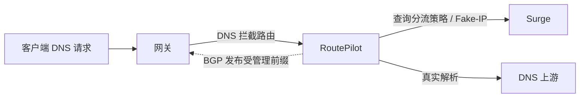

<p align="center">
  
</p>

# RoutePilot 🧭

**给 DNS 选路，让网关跟上。**

RoutePilot 是一款 macOS 状态栏应用：向 Surge 查询分流策略，为 DNS 请求选择真实解析或 Fake-IP，再通过内置 GoBGP 把受管理的路由发布给网关。

从状态栏看运行情况，在管理窗口调整配置，也可以让 AI agent 通过 CLI 帮你打理网络。React 管理界面随 Go 后台一起打包，配置与持久化数据保存在 SQLite。

[📦 下载最新版本](https://gitea.knotding.com/knot/routepilot/releases) · [🚀 快速开始](#quick-start) · [🤖 安装 skill](#agent-skill) · [📚 文档导航](#documentation)

## ✨ 能做什么？

| 功能 | 一句话了解 |
| --- | --- |
| DNS 分流 | 根据 Surge 策略选择真实地址或 Fake-IP，支持 UDP / TCP / DoT / DoH 和策略专用上游 |
| 路由发布 | BGP、Static、Hybrid 三种模式，管理 Fake-IP、DNS 拦截前缀与手动路由 |
| 规则维护 | URL 导入先预览，定时同步 IPv4、IPv6 或两者，支持批量删除 |
| 本地解析 | 自定义域名、通配符和 TTL，也可导入 Surge `[Host]` 静态映射 |
| 缓存与统计 | 持久化累计 DNS 统计和稳定决策，响应缓存可开启持久化与乐观刷新 |
| 状态与告警 | 流动图标、可选状态栏指标、健康检查、异常通知与 Webhook |
| 远程与升级 | 一处切换多台后端，保存登录凭证，在线升级完整 App 与网络服务 |
| AI agent 控制 | JSON CLI 与 `routepilot-control` skill，支持多种 agent 集成 |

<a id="quick-start"></a>

## 🚀 快速开始

1. 从 [Releases](https://gitea.knotding.com/knot/routepilot/releases) 下载 **RoutePilot-macos-arm64.dmg**，将 **RoutePilot.app** 拖入 `/Applications`。目前发布包面向 **Apple Silicon，macOS 13 及以上**。
2. 启动 App，从状态栏打开管理窗口。默认管理地址为 `http://127.0.0.1:1055`，也能通过浏览器访问；已有本机后台时直接连接。
3. 按下面的步骤配置 Surge、DNS 和路由。需要透明 DNS / PF 时，在状态栏菜单安装**网络后台服务**，首次安装需管理员授权。

管理窗口会记住尺寸；关闭窗口后 App 继续在状态栏运行。退出 App 会停止它自己启动的后台子进程，独立安装的常驻网络服务继续运行。

> 发布包目前使用 ad-hoc 签名，尚未使用 Developer ID 签名或 Apple 公证。

## 🗺️ 第一次配置

先理顺包的路径，再开启透明拦截。RoutePilot 不会自动修改 Surge、客户端 DNS 或网关配置。



| 步骤 | 配置与确认 |
| --- | --- |
| ① DNS 出口 | 在「设置 → DNS」填写物理出口接口、已分配的源地址、网关和真实上游。UDP / TCP 填 IP 与端口；DoT 另填证书名称，DoH 填 HTTPS URL。 |
| ② Surge | 核对 CLI、Fake-IP DNS、Fake-IP 网段和各地址族下一跳。常驻后台以 root 运行时，CLI 降权到桌面用户，也可指定 Surge 用户。 |
| ③ 防止回流 | 在网关设置高优先级源策略，让 Controller 的上游请求走不含拦截路由的 WAN 路径。固定本机出口接口不能替代网关策略，验证后再确认绕行。 |
| ④ 路由 | 在「设置 → 路由」选择后端和分流模式。BGP 邻居可复用全局 ASN、Router ID；Fake-IP 下一跳指向 Surge，DNS 拦截下一跳指向 Controller。 |
| ⑤ 透明拦截 | 添加解析器前缀、实际接收接口和具体监听地址（建议端口 1054）。需要 PF 权限，根规则须可到达 `com.apple/*`；应用仅管理自己的锚点。 |
| ⑥ 切换流量 | 关闭 Surge 的全量 `hijack-dns = *:53`，保留原有 `dns-server`。客户端请求应先经过正常网关；仅更改上游 DNS 无法改变被 Surge 抢先接收的路径。 |
| ⑦ 核对结果 | 检查 BGP 邻居、Adj-RIB-Out、稳定等待，以及网关 RIB / FIB 和实际包路径；Static 模式需在网关手动安装并确认。 |

### 路由模式怎么选？

| 模式 | 路由由谁安装 | 适合的场景 |
| --- | --- | --- |
| **BGP** | RoutePilot 向邻居发布 | 网关支持 BGP，希望路由随会话状态撤销 |
| **Static** | 你在外部网关配置 | 不使用 BGP，自行维护静态路由与故障切换 |
| **Hybrid** | Fake-IP 与 DNS 拦截分别选择 | 需要组合两种方式 |

Static 的确认表示用户已完成外部配置，RoutePilot 不自动安装或验证。静态 DNS 拦截还需开启持久拦截许可，并准备外部故障切换。路由表显示发布或配置状态；独立 TCP 诊断只检查 Mac 到指定地址的连通性。

DNS 查询不会生成单 IP BGP 路由。Surge 不可用时停止新 Fake-IP、回退真实 DNS；已发行地址保留 TTL / 宽限期，切换路由后端前需要等待排空。

**部署边界：** IPv4 透明 UDP / TCP DNS 已有 macOS PF 与抓包验证；IPv6 的实际 PF / WAN 路径尚未验收，默认关闭。解析器前缀路由影响该地址的全部流量，透明入口仅处理 UDP / TCP 53，还需考虑 DoH / DoT 等流量。

更多配置见 [路由后端说明](docs/routing-backends.md) 和 [透明 DNS 部署指南](docs/phase-2-acceptance.md)。

## 🎛️ 日常使用

### 规则导入一次，后续自动跟进

在 **手动路由 → 从 URL 导入** 中，提供公开 HTTP(S) 文本，每行一个 IP 或 CIDR，支持 `#` 注释。预览会列出无效、重复和已有条目，再选择地址族、下一跳及路由属性。

支持每 **1 / 6 / 12 小时、每天或每周** 自动更新，可单独同步 IPv4、IPv6 或两者。新增与移除的前缀只作用于该来源管理的路由；停止更新会保留当前条目。远程模式由选中的后端抓取列表。

### DNS 行为按需调整

- **本地 DNS**：支持多个 IPv4 / IPv6 地址、TTL、精确域名与通配符；手动条目优先。Surge `[Host]` 导入为快照，重新导入保留手动条目，不执行脚本或导入 Fake-IP 映射。
- **策略专用 DNS**：按 Surge 的 `final_policy` 或 `policy` 名称配置上游与失败回退。超时、连接错误、SERVFAIL 可触发备用，NXDOMAIN 和正常空响应不触发。
- **AAAA 回落**：Surge 关闭 IPv6 时，可沿用分流规则、返回成功空响应，或直接查询真实上游。回落优先于本地 Hosts 和 `always-real-ip`；Surge 状态未知时沿用原有规则。
- **分流模式**：在「设置 → 路由」选择自动分流、强制直连或全部交给 Surge；总览旁显示当前模式。

### 缓存：先响应，再刷新 ⚡

**设置 → 缓存** 提供乐观决策缓存和乐观响应缓存两个独立开关，默认关闭：

| 选项 | 开启后的行为 |
| --- | --- |
| 乐观决策缓存 | 确认 Surge 配置或外部资源变化后，先使用旧决策；命中时可按需刷新，也可在空闲时自动刷新。空闲自动刷新可单独关闭；刷新失败或 UNKNOWN 时保留旧值并重试 |
| 乐观响应缓存 | TTL 到期后仍保留上游响应，先返回旧响应；命中时可按需查询上游，也可在空闲时自动刷新。空闲自动刷新可单独关闭。定期持久化，重启也恢复过期响应 |

`optimistic_idle_refresh` 与 `optimistic_response_idle_refresh` 分别控制乐观决策缓存和乐观响应缓存的空闲自动刷新，默认开启以兼容现有行为。关闭空闲自动刷新不影响命中时的按需刷新，也不影响旧缓存的保留与立即响应。稳定的 DIRECT / SURGE / REJECT 决策会持久化；UNKNOWN 与求值错误不跨重启保留。响应缓存保留原始过期时间，过期响应向客户端返回 30 秒 TTL；手动清理、容量限制和不适用配置仍会使缓存失效。乐观缓存不改变 Fake-IP 的路由与健康门禁。关闭乐观响应缓存并应用成功时，只清理已过期响应，保留 TTL 内的响应及其原始过期时间；关闭状态下不做响应缓存持久化。

开启 `optimistic_idle_refresh` 时，待刷新决策会在至少 1 秒没有 DNS 请求、且求值队列空闲时自动刷新，每次一条、每秒最多启动 4 条；新请求到来时取消空闲刷新，实时查询优先。刷新沿用原客户端 IP 与查询类型，并轮流处理条目，避免失败域名阻塞其他决策。乐观响应缓存的空闲刷新也会等待 1 秒无 DNS 请求，每次仅刷新一条，且被新请求取消。

配置校验并保存成功后，页面立即反馈；服务重启、路由调整和安全等待在后台执行。页面另行显示应用进度与失败原因，支持重新应用。**“已保存”与“已生效”分别展示，避免把等待误认为保存失败。**

## 📊 把运行状态放在眼前

在 **设置 → 状态栏** 中选择图标动画和附加指标：

- 每个流动的包只走一个分支，按 DIRECT / SURGE 比例随机分配；每秒 DNS 请求越多，动画越快。
- 可显示每秒 / 每分钟 DNS 请求数、累计请求与错误、分流或错误占比、BGP 路由数与容量占比、运行时间。
- 健康检查支持从现有检查项中选择状态、耗时、连续失败或成功次数。

状态栏数据来自**本机后台**，切换远程页面不改变来源。异常、离线、需要登录时使用对应状态图标；缺失指标显示 `—`。可以关闭动画，也会遵循 macOS“减少动态效果”设置。

### 异常提醒，恢复也报个平安 🔔

在 **设置 → 通知** 选择需要提醒的异常，例如 Surge API / DNS、BGP 邻居、DNS 监听器或指定策略组 / 节点。连续失败阈值用于容忍短暂抖动，可开启恢复通知和重复提醒。

| 通知方式 | 使用方式 |
| --- | --- |
| App 系统通知 | 允许 macOS 通知权限，监控本机及当前已登录的远程连接；关闭管理窗口后仍可监控 |
| 后台 Webhook | 后端向配置的 HTTP(S) 地址发送 JSON；App 或页面关闭后仍能推送 |

Webhook 依赖后台和网络仍可用；后台整个失联时，由连接它的 App 提醒。普通浏览器通知需要保持页面打开。

**设置 → Surge → Surge 异常重启** 可选 HTTP API、Surge DNS、指定策略组或节点作为恢复依据。支持连续失败次数、异常持续时间、启动宽限、冷却期与每小时上限，通过 CLI 的 `restart-engine` 重启引擎。此功能需主动启用，重启会中断 Surge 现有连接。

## 🌍 本地、远程，一个管理窗口

在**侧栏底部**查看连接、添加或切换远程后端、退出登录；手机端从导航抽屉进入。状态、配置、查询与缓存操作都发往当前选中的服务。

远程服务需开启认证，并将本地 Controller 的出口地址加入允许的管理网段。**支持 HTTP 和 HTTPS，TLS 可选**；使用 HTTPS 时证书须受本机信任。后端网段限制与 macOS 本地网络权限分别管理。

### 保存凭证，下次直接进入

App 菜单的 **应用偏好 → 登录凭证保存方式** 可选 macOS 钥匙串或本地文件，两者均支持本机和远程登录。远程凭证按连接 ID 与地址分别保存，密码不写入连接配置、导出备份或网页存储。

升级后重新打开管理窗口，会恢复此前选择的连接，并使用已保存凭证自动登录；未保存或凭证失效时才需要手动输入。两种存储独立，切换不会迁移凭证，需在所选方式下登录一次。普通浏览器使用自己的密码管理器。

### 更新完整应用，不再分开升级

**设置 → 软件更新** 支持自动检查、自动下载、自动安装与更新提示；升级窗口提供**跳过该版本 / 稍后升级 / 立即升级**，可展开 Markdown 更新说明。

- **本机升级**：同步更新 App、管理页面与已安装的网络服务。App 放在 `/Applications` 后可启用更新助手，首次管理员授权后避免每次升级重复输入密码。
- **远程升级**：由目标 Mac 下载、校验并安装完整应用。浏览器直连管理页也能发起升级，更新的是后台所在 Mac；需要认证及标准安装的后台服务。
- **远端重启**：先通知使用者；App 在前台或管理窗口可见时由远端确认，只有后台运行时自动重启。

更新保留配置、数据库和凭证，短暂重启网络服务。安装包校验 SHA256、代码签名、应用身份与版本；服务未就绪时尝试恢复旧程序。App 与后台版本不一致时会提示更新。

详细设置见 [远程管理与升级](docs/remote-management.md)。

<a id="agent-skill"></a>

## 🤖 让 AI agent 帮你掌舵

`routepilot` CLI 支持状态、DNS 决策、缓存、BGP、路由、配置和完整 App 升级，默认输出 JSON。本机与远程后台使用同一套管理认证接口。

在 **设置 → CLI 与 skill** 启用 CLI，并将 `~/.local/bin` 加入 PATH：

```sh
routepilot status
routepilot help --json
```

App 可自动安装 `routepilot-control` skill，通过复选框同时选择多个 agent：**Codex、Claude Code、Hermes、Cursor、GitHub Copilot、Gemini CLI、OpenCode、Windsurf / Devin Desktop、Cline、Roo Code、Kilo Code、Antigravity、OpenClaw、Qwen Code、Amp、Pi**。同名内容可覆盖或跳过，默认覆盖并备份原内容。

### 一条命令安装 skill

让 AI agent 执行以下命令，默认安装到 Codex：

```sh
curl -fsSL https://gitea.knotding.com/knot/routepilot/raw/branch/main/scripts/install_skill.sh | sh
```

安装到 Claude Code 或 Hermes，也可同时指定多个 agent：

```sh
# Claude Code
curl -fsSL https://gitea.knotding.com/knot/routepilot/raw/branch/main/scripts/install_skill.sh | sh -s -- --agent claude

# Hermes
curl -fsSL https://gitea.knotding.com/knot/routepilot/raw/branch/main/scripts/install_skill.sh | sh -s -- --agent hermes

# 同时安装到多个 agent
curl -fsSL https://gitea.knotding.com/knot/routepilot/raw/branch/main/scripts/install_skill.sh | sh -s -- --agent codex --agent cursor --agent gemini
```

安装器从官方仓库获取 **v0.6.6** 的 skill，无需克隆、编译或管理员权限。默认覆盖并备份；追加 `--on-conflict skip` 可保留现有内容。安装 skill 不会启用 CLI 或保存登录凭证，使用前请在 App 设置中启用 CLI，并让 agent 重新加载 skills。

[CLI 使用与安装目录](docs/cli.md) · [安装脚本源码](scripts/install_skill.sh)

## 💾 数据与凭证

| 内容 | 保存位置或方式 |
| --- | --- |
| App 启动的用户后台数据 | `~/Library/Application Support/RoutePilot` |
| 常驻服务配置与数据库 | `/var/db/surge-controller` |
| 常驻服务程序与日志 | `/usr/local/libexec/surge-controller`、`/var/log/surge-controller/service.log` |
| 登录凭证 | macOS 钥匙串，或 `~/Library/Application Support/RoutePilot/Credentials` |
| 配置、事件、累计统计、稳定决策及乐观响应缓存 | SQLite，事件和缓存有容量上限 |
| 逐条 DNS 查询历史 | 有界内存，不写入数据库或服务日志 |

累计统计和持久化缓存定期保存，正常停止时保存最终值；强制结束可能丢失最近尚未保存的增量。缓存可能包含域名与客户端地址。

本地凭证文件以明文保存，目录权限 `0700`、文件权限 `0600`，同一用户的其他程序仍可能读取。数据库目录与密钥也限制权限；配置导出不包含密码哈希或 API token，迁移机器需重新配置相关凭据。不要让两个实例共用数据库。

## 🛠️ 从源码运行

需要 **Go 1.26+、Node.js 22.12+、npm**；原生 App 另需 Apple Command Line Tools。实际 PF 与固定接口出口仅支持 macOS。

```sh
go mod download
npm --prefix web ci
make build
bin/surge-controller serve --database /ABSOLUTE/PRIVATE/DIRECTORY/controller.sqlite
```

| 命令 | 用途 |
| --- | --- |
| `make build` | 构建前端、后台、DNS 探测工具和 CLI |
| `make cli` | 单独构建 CLI |
| `make app` / `make package` | 构建完整 App、DMG 和 ZIP |
| `make clean-artifacts` | 清除历史构建产物；构建前也会自动清理 |
| `make verify` | 前端测试、Go race 测试、go vet 与构建 |

默认仅开放本机管理，BGP 与透明拦截关闭。未配置出口接口和源地址时，Fake-IP 门禁保持关闭。

常驻服务可用 [安装脚本](scripts/install_macos.sh) 安装、[移除脚本](scripts/uninstall_macos.sh) 移除；移除保留数据库、密钥和日志。推送版本标签后，[Gitea Release 工作流](.gitea/workflows/release.yaml) 在 Apple Silicon 的 `macos-arm64` Runner 上构建并上传 **DMG、ZIP、SHA256SUMS**。

## 🧰 遇到问题，从这里查起

| 现象 | 优先检查 |
| --- | --- |
| DNS 未启动 | 页面告警、出口接口、源地址、端口占用和服务权限 |
| 透明 DNS 超时 | 接收接口、PF 规则、网关源策略与实际出口路径 |
| Fake-IP 门禁关闭 | Surge 健康、路由后端、静态确认或 BGP 发布、稳定等待 |
| BGP 路由没到网关 | 邻居会话、Adj-RIB-Out、下一跳与网关 RIB / FIB |
| `management client network is not allowed` | 目标后台允许网段是否包含本地 Controller 的出口地址 |
| 前后端版本不一致 | App 与实际连接的后台是否都已更新 |
| Surge CLI 不可达 | Surge 用户、运行状态和本地 IPC |
| PF 清理被拒绝 | 自身锚点所有权与旧进程；不要全局关闭或 flush PF |

<a id="documentation"></a>

## 📚 继续探索

| 文档 | 内容 |
| --- | --- |
| [架构说明](docs/architecture.md) | DNS、Surge、路由与管理层如何配合 |
| [路由配置](docs/routing-backends.md) · [FRR 导出](docs/frr-export.md) | 后端模式、下一跳和邻居配置 |
| [远程管理](docs/remote-management.md) | 认证、连接、完整应用升级与通知 |
| [CLI 与 skill](docs/cli.md) | 命令、agent 安装目录与自动化示例 |
| [透明 DNS 部署](docs/phase-2-acceptance.md) · [实测记录](docs/phase-2-docker-evidence.md) | 网络路径、部署步骤与验证边界 |
| [工程规格](docs/engineering-specification.md) · [运行不变量](docs/acceptance.md) | 实现约束与故障处理原则 |
